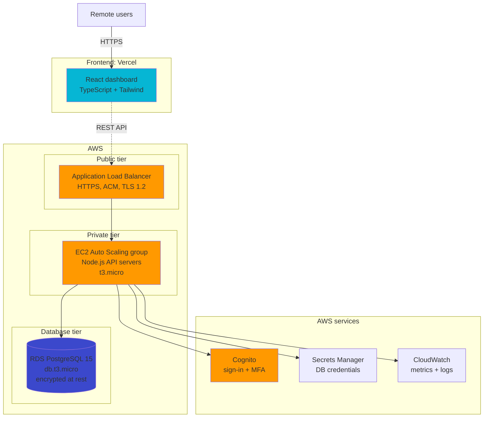

# Zero-Trust Remote Workforce Platform

A remote workforce dashboard on a 3-tier, zero-trust AWS network, built with Terraform. Only the load balancer is public. The API servers and the PostgreSQL database sit in private subnets, each tier only accepts traffic from the one in front of it, and users sign in through Cognito with optional MFA. The React + TypeScript frontend is deployed on Vercel.

**Frontend demo:** [remote-workforce-platform.vercel.app](https://remote-workforce-platform.vercel.app/)

The demo dashboard runs on generated sample data that updates every few seconds. Connecting it to the API and CloudWatch is the next step (see the end of this README).

## Architecture



## AWS infrastructure

| Part | Details |
| --- | --- |
| VPC | Public, private and database subnets across two Availability Zones |
| Compute | EC2 Auto Scaling group (t3.micro) behind an ALB; unhealthy instances are replaced |
| Database | RDS PostgreSQL 15 (db.t3.micro) in private subnets, AES-256 at rest, TLS 1.2 in transit |
| Sign-in | Cognito user pool with optional TOTP MFA |
| Secrets | Database credentials in Secrets Manager, not in the code |
| Access | Security groups allow only the ports each tier needs; EC2 uses instance profiles, so there are no stored keys |
| Monitoring | CloudWatch metrics, logs and alarms |

The ALB and API instances span two Availability Zones. RDS is single-AZ to stay in the Free Tier; `multi_az = true` turns on failover.

### Terraform layout

```
terraform/
├── modules/
│   ├── vpc/          # VPC, subnets, security groups
│   ├── ec2/          # ALB, Auto Scaling group, launch template
│   ├── rds/          # PostgreSQL and its secret
│   ├── cognito/      # user pool
│   └── monitoring/   # CloudWatch alarms
└── environments/
    └── prod/         # production configuration
```

## Cost

| Part | What drives the cost | What I chose |
| --- | --- | --- |
| Frontend | Vercel hobby tier | Free |
| NAT Gateway | About $32 a month plus data, the biggest cost | One NAT Gateway shared by both private subnets instead of one per AZ. Saves about $32 a month; the trade-off is that private-subnet internet access depends on one AZ |
| Load balancer | Hourly plus capacity units | One ALB with path-based routing for every service |
| EC2 and RDS | Instance hours | Free Tier sizes; single-AZ RDS |
| Secrets Manager | $0.40 per secret a month | Only the database credentials |

I run `terraform destroy` after each demo to stop the hourly charges.

## Frontend

React 18.2, TypeScript 5.3 in strict mode, Vite, Tailwind CSS 3.4, Recharts for the activity chart, Framer Motion for small animations and Lucide icons. It has a stats grid, a 24-hour activity chart, a security event log you can filter by severity, and a system status panel. Vercel builds and deploys it on every push. Details are in [`frontend/README.md`](frontend/README.md).

Performance: Lighthouse 95+, about 180 KB gzipped, first contentful paint under 1.2 s. A full `terraform apply` takes about 18 minutes.

## Deploy it

**Frontend**

```bash
cd frontend
npm install
npm run build
vercel --prod
```

**AWS**

```bash
cd terraform/environments/prod
terraform init
terraform plan -out=tfplan
terraform apply tfplan
```

## Problems I hit

**TypeScript strict mode broke the build.** Custom hooks returned values that were never used. I removed the dead code and only destructured what each component needs:

```typescript
// Before: the build fails on an unused variable
const { totalSessions } = useRealtimeData()

// After
const { activeUsers, securityScore } = useRealtimeData()
```

**Shell variables vanished from EC2 user data.** Terraform interpolated `${VAR}` before the script ran. Escaping with `$$` and using single-quoted heredocs fixed it:

```bash
echo "Port: $${PORT}"
```

**Instances failed ALB health checks.** The Express backend sent no CORS headers. Adding CORS middleware before the router fixed it:

```javascript
app.use(cors({
  origin: ['http://localhost:3000', /\.vercel\.app$/],
  credentials: true
}))
```

**`npm audit` flagged eight vulnerabilities before a Vercel deploy.** All eight were in build-only devDependencies. `npm audit fix` applied the non-breaking patches.

## What I'd do next

- Connect the dashboard to the API and CloudWatch instead of sample data
- Multi-AZ RDS, mandatory MFA and Secrets Manager rotation
- A CPU-based scaling policy for the Auto Scaling group
- A GitHub Actions pipeline for the Terraform

## License

MIT

---

Anyasi Chineme · [Portfolio](https://www.anyasichineme.com/) · [GitHub](https://github.com/cyberN3m3) · [Email](mailto:Anyasiprecious5@gmail.com)
